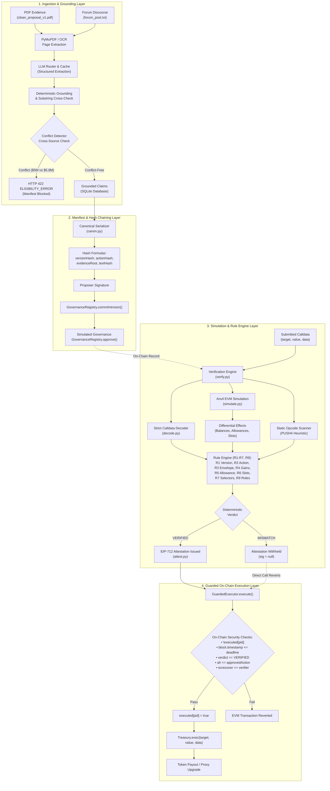

# DAO Accountability Engine — CASCADE 4.1

> **CASCADE ’26 — Problem 4.1: DAO Accountability Engine**
> Proving that what a DAO actually executes matches what voters were asked to approve.

[](file:///Users/althea/Developer/Projects/iiitn-cascade/cascade4.1/contracts)
[](file:///Users/althea/Developer/Projects/iiitn-cascade/cascade4.1/backend)
[](file:///Users/althea/Developer/Projects/iiitn-cascade/cascade4.1/frontend)
[](file:///Users/althea/Developer/Projects/iiitn-cascade/cascade4.1/contracts)
[-blue)](file:///Users/althea/Developer/Projects/iiitn-cascade/cascade4.1/backend)
[](file:///Users/althea/Developer/Projects/iiitn-cascade/cascade4.1/backend/app/verification)

---

## 1. Concise Basic Theory: What We Are Doing and Why

### The Governance Blindspot
In modern decentralized autonomous organizations (e.g. OpenZeppelin `Governor`), proposal integrity is mathematically bound to transaction calldata:
$$\text{proposalId} = \text{keccak256}(\text{abi.encode}(\text{targets}, \text{values}, \text{calldatas}, \text{descriptionHash}))$$

This prevents malicious actors from swapping raw calldata after a vote has closed. **However, DAO voters, delegates, and tokenholders do not read or audit hex calldata.** They read natural-language proposal prose, Discourse forum discussions, and financial grant PDFs.

A severe accountability gap exists between **what voters understood they were approving** and **what the submitted smart contract transaction actually does**:
- **Discrepant Financial Payouts:** A proposal text describes a \$1.0M grant, but the associated calldata executes a \$5.0M withdrawal.
- **Calldata Parameter Tampering:** Voters approve a grant to researcher Alice, but the submitted transaction diverts funds to an attacker address.
- **Hidden Upgrade Backdoors:** A governance proposal describes a routine, benign V2 protocol upgrade, but the compiled bytecode introduces an undeclared `sweep()` backdoor that drains protocol collateral.
- **Unapproved Privilege Grants:** Routine payout transactions that sneak in an `approve(attacker, type(uint256).max)` token allowance.
- **Contradictory Supporting Evidence:** The official grant PDF requests \$5.0M, but forum discussions claim \$5.8M.

### The CASCADE Solution
CASCADE 4.1 eliminates this blindspot by establishing a deterministic, verifiable **Chain of Accountability**:
1. **Evidence Ingestion & Grounding:** Proposal documents (PDFs and text) are ingested, and factual claims are extracted and deterministically verified as exact character substrings of the source text.
2. **Conflict Gating:** Cross-source discrepancies (e.g. \$5.0M vs \$5.8M) are caught automatically, locking proposal drafting until resolved.
3. **Canonical Manifest & On-Chain Hashing:** Confirmed claims form a deterministic canonical manifest committed to a sequential hash chain on `GovernanceRegistry.sol`.
4. **EVM Simulation Sandbox:** Submitted transactions are simulated off-chain against an Anvil EVM snapshot through `Treasury.exec` with executor impersonation, observing watched balance changes, allowances, and proxy storage slots.
5. **Deterministic Rule Verification (R1–R7, R9):** Python rules compare observed simulation effects against the approved manifest. The LLM **never** decides verdicts.
6. **EIP-712 Attestation:** A trusted verifier issues a cryptographic attestation **only** if all 8 rules evaluate to `VERIFIED`.
7. **Guarded On-Chain Execution:** The `GuardedExecutor.sol` contract enforces single-use execution, verifies the attestation signature and action hash, and routes execution through `Treasury.sol`.

---

## 2. Complete Tech Stack

```
+----------------------------------------------------------------------------------------------------+
|                                    CASCADE 4.1 TECH STACK                                         |
+------------------------------------+----------------------------------+----------------------------+
| SMART CONTRACTS & EVM              | BACKEND & VERIFICATION ENGINE    | FRONTEND WORKBENCH         |
+------------------------------------+----------------------------------+----------------------------+
| • Solidity 0.8.30 (Cancun EVM)     | • Python 3.11 pinned via uv      | • React 19 + TypeScript    |
| • Foundry (forge, anvil, cast)     | • FastAPI 0.135.1 (REST API)     | • Vite 8.3.5 build engine  |
| • OpenZeppelin Contracts v5.4.0    | • Web3.py & eth-account (EIP-712)| • Oxlint (116 lint rules)  |
|   - ERC-20 (MockToken)             | • PyMuPDF (fitz) digital text    | • Tokenized CSS system:    |
|   - EIP-712 Typed Data Signing     | • RapidOCR (fallback OCR engine) |   - Dark `#080A0D` theme   |
|   - ECDSA Signature Recovery       | • Pydantic v2 schemas            |   - `#7CE0BE` mint accents |
|   - UUPSUpgradeable & ERC1967Proxy | • SQLite3 (Python stdlib)        |   - Travelling grid lines  |
| • Anvil Local Chain (Chain 31337)  | • NetworkX (COI provenance graph)| • Read-only Web3 viewer    |
| • Public Testnets (Sepolia/Base)   | • httpx (resilient async calls)  | • Zero-dependency SVGs     |
+------------------------------------+----------------------------------+----------------------------+
```

---

## 3. System Architecture & Component Mapping



### Smart Contract Responsibilities (`contracts/src/`)
1. **[`MockToken.sol`](file:///Users/althea/Developer/Projects/iiitn-cascade/cascade4.1/contracts/src/MockToken.sol):** OpenZeppelin ERC-20 token (6 decimals, mimicking USDC). Minting is restricted to deployer (`onlyDeployer`) to prevent unauthorized balance inflation.
2. **[`GovernanceRegistry.sol`](file:///Users/althea/Developer/Projects/iiitn-cascade/cascade4.1/contracts/src/GovernanceRegistry.sol):**
   - **Proposer Ownership:** First committer of a `proposalId` owns it. Versions are sequential and 1-indexed.
   - **Revision Invalidation:** Calling `commitVersion` automatically executes `delete _approved[pid]`, ensuring prior approvals become invalid if proposal text changes.
   - **Approval Storage:** `approve(pid, versionHash)` copies `(versionHash, actionHash, evidenceRoot)` into `approved[pid]`.
3. **[`Treasury.sol`](file:///Users/althea/Developer/Projects/iiitn-cascade/cascade4.1/contracts/src/Treasury.sol):** Vault holding DAO USDC tokens and proxy ownership. Dispatches calls via `exec(target, value, data)`. Call access is strictly restricted: `require(msg.sender == executor, "only executor")`. `setExecutor` can only be executed once by the deployer.
4. **[`GuardedExecutor.sol`](file:///Users/althea/Developer/Projects/iiitn-cascade/cascade4.1/contracts/src/GuardedExecutor.sol):** The trust anchor of the system:
   - Inherits OpenZeppelin `EIP712` and `ECDSA`.
   - Replay protection: `require(!executed[pid], "already executed")`.
   - Deadline validation: `require(block.timestamp <= deadline, "attestation expired")`.
   - Verdict enforcement: `require(verdict == VERIFIED, "not verified")`.
   - Action binding: `require(ah == approvedAction, "action mismatch")`.
   - Signature recovery: `require(ECDSA.recover(digest, sig) == verifier, "bad attestation")`.
   - Checks-Effects-Interactions: Sets `executed[pid] = true` before calling `treasury.exec(...)`.
5. **UUPS Upgrade Contracts ([`BoxUUPS.sol`](file:///Users/althea/Developer/Projects/iiitn-cascade/cascade4.1/contracts/src/BoxUUPS.sol), [`BoxV2.sol`](file:///Users/althea/Developer/Projects/iiitn-cascade/cascade4.1/contracts/src/BoxV2.sol), [`BoxEvil.sol`](file:///Users/althea/Developer/Projects/iiitn-cascade/cascade4.1/contracts/src/BoxEvil.sol)):**
   - Deployed behind OpenZeppelin `ERC1967Proxy` owned by `Treasury`.
   - `BoxUUPS`: Initial implementation V1 ("1.0.0"), `setValue()`, `getValue()`.
   - `BoxV2`: Benign V2 upgrade ("2.0.0"), adds `increment()`.
   - `BoxEvil`: Malicious V2 implementation containing an undeclared `sweep()` backdoor (`0x35faa416`).

---

## 4. The 8-Stage Accountability Pipeline

```
Evidence (PDF/Txt) ➔ Grounded Claims ➔ Canonical Manifest ➔ Governance Approval ➔ EVM Simulation ➔ Deterministic Rules ➔ EIP-712 Attestation ➔ Guarded Execution
```

1. **Stage 1 — Evidence Ingestion (`backend/app/ingestion/`):** PyMuPDF extracts native text with 1-indexed page coordinates (`{"1": "...", "2": "..."}`). Pages with fewer than 50 characters trigger RapidOCR fallback. SHA-256 deduplication prevents redundant processing.
2. **Stage 2 — Grounded Claims Extraction (`backend/app/claims/`):** Candidate claims follow a strict Pydantic schema (`field`, `value`, `quote`, `source_id`, `page`, `confidence`). Quotes must match character-by-character as exact substrings of normalized page text. Monetary numbers in quotes are verified against claimed values via `Decimal`.
3. **Stage 3 — Cross-Source Conflict Gating (`backend/app/claims/conflicts.py`):** Claims across differing sources are cross-checked. Discrepancies (e.g. \$5.0M PDF vs \$5.8M forum post) flag a `CONFLICT` record, mark claims `UNCERTAIN`, and deterministically block manifest drafting with HTTP 422 `ELIGIBILITY_ERROR`.
4. **Stage 4 — Canonical Manifest Construction (`backend/app/manifest/`):** Verified claims are serialized deterministically (sorted keys, no whitespace, UTF-8, integer strings, lowercased addresses). Cryptographic commitments are calculated:
   - $\text{proposalTextHash} = \text{keccak256}(\text{UTF-8 proposal prose})$
   - $\text{evidenceRoot} = \text{keccak256}(\text{concatenation of sorted 32-byte SHA-256 evidence digests})$
   - $\text{versionHash}_v = \text{keccak256}(\text{canonical\_json}_v \parallel \text{versionHash}_{v-1})$
   - $\text{actionHash} = \text{keccak256}(\text{abi.encode}(\text{target}, \text{value}, \text{keccak256}(\text{calldata})))$
5. **Stage 5 — On-Chain Commitment & Governance Approval (`backend/app/chain/client.py`):** The proposer commits hashes to `GovernanceRegistry.commitVersion()`. Simulated governance (`PK_GOVERNANCE`) reviews and calls `approve(pid, versionHash)`.
6. **Stage 6 — Anvil EVM Simulation Sandbox (`backend/app/verification/simulate.py`):** Takes a raw JSON-RPC `evm_snapshot`, impersonates the executor via `anvil_impersonateAccount`, executes `treasury.exec`, captures differential balance/slot effects on watched addresses, and restores state cleanly via `evm_revert`.
7. **Stage 7 — Deterministic Verification Engine (`backend/app/verification/verify.py`):**
   Evaluates 8 deterministic rules (R1–R7, R9; Rule R8 is unassigned in the specification):
   - **R1 (Version):** Recomputes `versionHash` and asserts on-chain governance match.
   - **R2 (Action):** Computes `actionHash` from submitted calldata; checks field-level diff against manifest.
   - **R3 (Envelope):** Asserts Treasury outflow $\le \text{maxAllowedOutflow}$ and Recipient inflow $\ge \text{expectedInflow}$.
   - **R4 (Prohibited Gains):** Asserts zero unexpected balance increases on unapproved watched accounts.
   - **R5 (Allowances):** Asserts Treasury token allowances remain strictly unchanged.
   - **R6 (Implementation Slot):** Asserts EIP-1967 slot immutability for payouts; exact match with `newImpl` for upgrades.
   - **R7 (Selector Scope):** Scans runtime bytecode for candidate selectors via `PUSH4` opcode heuristic; asserts selectors reside within $\text{baselineSelectors} \cup \text{declaredSelectors}$. Fails `BoxEvil` undeclared `sweep()` backdoor.
   - **R9 (Ownership/Roles):** Asserts contract ownership (`owner()`) and access roles remain unchanged.
8. **Stage 8 — EIP-712 Attestation & Guarded Execution (`contracts/src/GuardedExecutor.sol`):** If all rules evaluate to `VERIFIED`, the verifier key signs an EIP-712 typed attestation with a deadline derived from chain time. `GuardedExecutor.execute` verifies the signature, enforces single-use execution, and routes the transaction to `Treasury.exec`.

---

## 5. Demonstration Scenarios Matrix

CASCADE 4.1 features 5 automated scenarios that can be executed from the interactive UI or via the API:

| Scenario | Proposal ID | Action / Payload | Expected Verdict | Defense / Enforcement Outcome |
| :---: | :---: | :--- | :---: | :--- |
| **A** | `PROP-002` | Valid 1,000,000 USDC payout to Alice | `VERIFIED` | All 8 rules pass; attestation issued; mined on-chain; Treasury balance -1M USDC; Recipient +1M USDC. |
| **B1** | `PROP-B1` | Calldata substituted with attacker address | `MISMATCH` | Rule R2 fails (`actionHash` mismatch); attestation withheld; contract call reverts; balances protected. |
| **B2** | `PROP-B2` | Benign V2 protocol upgrade (`BoxV2`) | `VERIFIED` | Declared selectors pass R1–R7; attestation issued; proxy implementation slot updated on-chain to `BoxV2` ("2.0.0"). |
| **B3** | `PROP-B3` | Malicious upgrade with `sweep()` (`BoxEvil`) | `MISMATCH` | Rule R7 fails on undeclared selector `0x35faa416`; attestation withheld; slot protected at `BoxUUPS`. |
| **C** | `PROP-002` | Automated clean environment reset & seed | — | Resets database tables, redeploys all 8 contracts, funds Treasury (1M USDC), seeds `PROP-002` in **~1.5s**. |

---

## 6. Initial Setup Guide (macOS & Windows)

### Prerequisites

| Tool | Version Required | Installation Check | Notes |
| :--- | :--- | :--- | :--- |
| **Git** | 2.30+ | `git --version` | Source control |
| **uv** | 0.5+ | `uv --version` | Fast Python package and environment manager |
| **Python** | 3.11.x (managed via uv) | `uv run python --version` | Pinned to Python 3.11 for Web3 / Swig / PyMuPDF stability |
| **Node.js & npm**| Node 20.19+ or 22+ | `node -v && npm -v` | Frontend build and runtime |
| **Foundry** | 1.8.6+ | `forge --version && anvil --version` | EVM toolchain (Solidity 0.8.30) |

---

### macOS Setup

#### 1. Install Prerequisites
```bash
# 1. Install Homebrew (if not already installed)
/bin/bash -c "$(curl -fsSL https://raw.githubusercontent.com/Homebrew/install/HEAD/install.sh)"

# 2. Install Node.js and Git
brew install node git

# 3. Install uv (Astral)
curl -LsSf https://astral.sh/uv/install.sh | sh
source $HOME/.cargo/env

# 4. Install Foundry
curl -L https://foundry.paradigm.xyz | bash
foundryup
```

#### 2. Clone and Configure Environment
```bash
git clone https://github.com/girjashankar01/cascade-4.1.git
cd cascade-4.1

# Copy environment template
cp .env.example .env
```

#### 3. Install Contracts & Backend Dependencies
```bash
# Compile and test Foundry smart contracts
cd contracts
forge build
forge test -vv
cd ..

# Sync Python 3.11 virtual environment via uv
cd backend
uv python install 3.11
uv python pin 3.11
uv sync --locked
uv run pytest -q
cd ..

# Install frontend dependencies
cd frontend
npm ci
npm run build
npm run lint
cd ..
```

---

### Windows Setup (PowerShell)

#### 1. Install Prerequisites
Run PowerShell as Administrator:
```powershell
# 1. Install Git and Node.js via winget
winget install --id Git.Git -e --source winget
winget install --id OpenJS.NodeJS.LTS -e --source winget

# 2. Install uv (Astral)
powershell -ExecutionPolicy ByPass -c "irm https://astral.sh/uv/install.ps1 | iex"

# 3. Install Foundry using project helper
./scripts/install-foundry.ps1
. ./scripts/dev-tools.ps1
forge --version
anvil --version
```

#### 2. Configure Environment & Dependencies
```powershell
# In repository root:
if (-not (Test-Path .env)) { Copy-Item .env.example .env }

# Session-only PATH helper (sets uv and foundry paths in PowerShell)
. ./scripts/dev-tools.ps1

# Compile and test Foundry smart contracts
cd contracts
forge build
forge test
cd ..

# Sync backend virtual environment via uv
cd backend
uv python install 3.11
uv python pin 3.11
uv sync --locked
uv run pytest
cd ..

# Install frontend dependencies
cd frontend
npm ci
npm run build
npm run lint
cd ..
```

---

## 7. Running the Application Locally

Start three separate terminals from the repository root:

### Terminal 1 — Local EVM Node (Anvil)
```bash
# macOS / Linux (bash/zsh)
./scripts/start_anvil.sh
# Or run Anvil directly with ephemeral state:
anvil --host 127.0.0.1 --silent

# Windows (PowerShell)
. ./scripts/dev-tools.ps1
anvil --host 127.0.0.1 --silent
```
*Anvil starts on `127.0.0.1:8545` with Chain ID `31337`.*

### Terminal 2 — Backend API Service (FastAPI)
```bash
# macOS / Linux
cd backend
uv run uvicorn app.main:app --reload --host 127.0.0.1 --port 8000

# Windows (PowerShell)
. ./scripts/dev-tools.ps1
cd backend
uv run uvicorn app.main:app --reload --host 127.0.0.1 --port 8000
```
*API interactive documentation is available at `http://127.0.0.1:8000/docs`.*

### Terminal 3 — Frontend Technical Workbench (Vite)
```bash
# macOS / Linux
cd frontend
npm run dev -- --host 127.0.0.1 --port 5173 --strictPort

# Windows (PowerShell)
cd frontend
npm run dev -- --host 127.0.0.1 --port 5173 --strictPort
```
*Open `http://127.0.0.1:5173` in your browser.*

---

## 8. Instant Clean-Start Reset & Reseed (1.5 Seconds)

To deploy fresh contracts, fund the Treasury with \$1,000,000 USDC, purge demo proposal tables, and seed proposal states from a clean baseline:

```bash
# From repository root:
uv run --project backend python scripts/deploy_and_seed.py
```

Expected output:
```
[INFO] [1/6] Validating local development environment & Anvil connectivity...
[INFO] [2/6] Initializing database & purging stale demo proposal records...
[INFO] [3/6] Deploying core DAO contracts (Token, Registry, Treasury, GuardedExecutor)...
[INFO] [4/6] Deploying UUPS upgrade contracts & ERC1967 proxy...
[INFO] [5/6] Seeding proposals (PROP-002 clean payout, PROP-001 genuine conflict)...
[INFO] [6/6] Verifying state invariants & persisting deployments.json...
[INFO] SUCCESS: Deployed and seeded CASCADE 4.1 in 1.51s
```

*Alternatively, execute **Scenario C** from the frontend workbench by clicking the **"Run Scenarios"** button in the TopBar and selecting **Scenario C**.*

---

## 9. Live Scenario Execution & Verification

### Executing Scenarios via Frontend Workbench
1. Open `http://127.0.0.1:5173`.
2. Click **"Run Scenarios (A / B1 / C)"** in the TopBar.
3. Select any scenario tab:
   - **Scenario A (Valid Payout):** Validates 8 rules, signs EIP-712 attestation, and transfers 1M USDC to Alice on-chain.
   - **Scenario B1 (Substituted Payout):** Detects recipient tampering under Rule R2, withholds attestation, and verifies on-chain revert.
   - **Scenario B2 (Benign Upgrade):** Upgrades proxy to `BoxV2` ("2.0.0") on-chain.
   - **Scenario B3 (Evil Upgrade Blocked):** Static opcode scanner flags undeclared `sweep()` backdoor under Rule R7, withholds attestation, and protects the proxy implementation slot.
   - **Scenario C (Reset & Seed):** Fast redeployment and re-seed.

### Executing Scenarios via CLI / curl
```bash
# Scenario A (Valid Payout)
curl -s -X POST http://127.0.0.1:8000/scenarios/A/run | jq .verdict
# Output: "VERIFIED"

# Scenario B1 (Tampering Defense)
curl -s -X POST http://127.0.0.1:8000/scenarios/B1/run | jq .verdict
# Output: "MISMATCH"

# Scenario B3 (Malicious Upgrade Defense)
curl -s -X POST http://127.0.0.1:8000/scenarios/B3/run | jq .verdict
# Output: "MISMATCH"

# Test Conflict Gate (PROP-001 with $5.0M vs $5.8M discrepancy)
curl -s -X POST http://127.0.0.1:8000/manifest/PROP-001 \
  -H "Content-Type: application/json" \
  -d '{"token_address":"0x21dF544947ba3E8b3c32561399E88B52Dc8b2823"}' | jq .detail
# Output: {"error":"ELIGIBILITY_ERROR","message":"Proposal 'PROP-001' has unresolved conflicts..."}
```

---

## 10. Running Test & Verification Suites

```bash
# 1. Smart Contracts Test Suite (Foundry)
cd contracts && forge test -vv
# Result: 28 tests passed across 4 suites (100% pass)

# 2. Backend Pytest Suite (uv)
cd backend && uv run pytest
# Result: 141 tests passed across 28 suites (100% pass)

# 3. Frontend Production Build & Oxlint
cd frontend && npm run build && npm run lint
# Result: Vite built in 143ms; Oxlint passed on 21 files with 0 warnings and 0 errors

# 4. Whitespace & Formatting Hygiene
git diff --check
# Result: Clean output (0 whitespace or newline errors)
```

---

## 11. Public Testnet Verification Proof (`docs/proof.json`)

In addition to local Anvil execution, CASCADE 4.1 supports publishing immutable cryptographic verification proofs to public EVM testnets:
- **Ethereum Sepolia** (`CHAIN_ID=11155111`)
- **Base Sepolia** (`CHAIN_ID=84532`)
- **Polygon Amoy** (`CHAIN_ID=80002`)

### Published Proof Artifact
The immutable proof artifact is committed to source control at [`docs/proof.json`](file:///Users/althea/Developer/Projects/iiitn-cascade/cascade4.1/docs/proof.json). It contains:
- Cryptographic commitments (`versionHash`, `actionHash`, `evidenceRoot`).
- Deployed contract addresses verified on Etherscan/Basescan/Polygonscan.
- Mined on-chain transaction receipts for version commitment, governance approval, calldata tampering rejection, and verified guarded execution.
- Contains **no private keys, API secrets, or sensitive credentials**.

### Inspecting Proof in UI
In the frontend workbench, navigate to **Audit Explorer**. The page calls `GET /proof` and dynamically generates clickable block explorer links for every mined transaction.

---

## 12. Project Directory Structure

```text
/Users/althea/Developer/Projects/iiitn-cascade/cascade4.1/
├── contracts/                  # Foundry Ethereum smart contracts
│   ├── src/                    # Production Solidity contracts (0.8.30)
│   │   ├── MockToken.sol       # ERC-20 (6 decimals) mimicking USDC with deployer mint
│   │   ├── GovernanceRegistry.sol # Sequential version chain & governance approval store
│   │   ├── Treasury.sol        # Vault contract holding DAO funds, restricted to executor
│   │   ├── GuardedExecutor.sol # EIP-712 attestation verifier & execution guard
│   │   ├── BoxUUPS.sol         # UUPS upgradeable implementation V1 (owned by Treasury)
│   │   ├── BoxV2.sol           # Benign V2 upgrade implementation
│   │   └── BoxEvil.sol         # Malicious V2 implementation with undeclared sweep() backdoor
│   ├── test/                   # Foundry test suites (28 tests)
│   ├── script/                 # Testnet deployment scripts (DeployProof.s.sol)
│   └── foundry.toml            # Foundry configuration (solc 0.8.30, EVM cancun)
├── backend/                    # Python 3.11 backend managed exclusively via uv
│   ├── app/                    # FastAPI application package
│   │   ├── main.py             # FastAPI entry point, lifespan, and /health endpoint
│   │   ├── db.py               # SQLite connection pool, schema initialization, table migrations
│   │   ├── api/routes.py       # 21 REST API endpoints
│   │   ├── ingestion/          # Document extraction (PyMuPDF native text + RapidOCR fallback)
│   │   ├── claims/             # Pydantic schemas, text grounding, conflict detection, COI graph
│   │   ├── manifest/           # Canonical serialization, cryptographic hashing, manifest builder
│   │   ├── verification/       # Strict calldata decoder, Anvil simulation, rule engine (R1-R7, R9)
│   │   ├── chain/              # Web3 client, EIP-712 attestation signing, contract bindings
│   │   ├── scenarios/          # Automated scenario runner (Scenarios A, B1, B2, B3, C)
│   │   └── llm/                # LLM router, OpenAI/Gemini providers, SQLite cache, error shielding
│   ├── tests/                  # Pytest test suites (141 tests across 28 files)
│   ├── data/                   # Runtime data directory (deployments.json, SQLite db)
│   └── pyproject.toml          # Project configuration, dependencies pinned to Python 3.11
├── frontend/                   # React 19 + TypeScript + Vite frontend workbench
│   ├── src/                    # Application source code
│   │   ├── main.tsx            # Vite DOM mount
│   │   ├── App.tsx             # Root component rendering AppShell
│   │   ├── api/                # API client (client.ts) and schema interfaces (types.ts)
│   │   ├── components/         # Reusable UI components (Sidebar, TopBar, LifecycleStrip, Modals)
│   │   ├── pages/              # Primary view pages (Overview, Execution, Proposals, Manifest, Audit)
│   │   └── styles/             # Modular CSS design system (tokens, background, components)
│   └── package.json            # Vite, React, TypeScript, Oxlint configuration
├── scripts/                    # Operational automation scripts
│   ├── deploy_and_seed.py      # Deterministic fast-reset and reseed automation (1.5s)
│   ├── start_anvil.sh          # Anvil launcher with state dump/load persistence
│   ├── check_chain.py          # Quick CLI chain health probe
│   ├── publish_proof.py        # Public testnet proof publisher
│   ├── dev-tools.ps1           # Windows PowerShell session-only PATH helper
│   └── install-foundry.ps1     # Windows Foundry installer helper
├── fixtures/                   # Sample proposals (clean_proposal_v1.pdf, forum_post.txt)
├── docs/                       # Project specifications, handoffs, and audit runbooks
│   ├── dao-build-guide-final.md # Authoritative technical specification
│   ├── project-architecture-guide.md # Comprehensive engineering map
│   ├── frontend-ui-reference.md # Complete UI controls & page-by-page catalog
│   ├── demo-runbook.md         # Step-by-step presenter demonstration script
│   ├── project-explanation-and-judge-qa.md # Concept breakdown & judge defense Q&A
│   ├── ui-usability-audit.md   # Usability findings and prioritized remediations
│   └── proof.json              # Mined public testnet cryptographic proof artifact
├── decisions.md                # Chronological record of architectural decisions
├── handoff.md                  # Milestone status and verification handoff logs
└── README.md                   # Setup guide, architecture, pipeline, and working overview
```

---

## 13. Documentation & Deep-Dive Reference Links

For comprehensive technical breakdowns, consult the dedicated guides in `docs/`:
- **Architecture & Component Map:** [`docs/project-architecture-guide.md`](file:///Users/althea/Developer/Projects/iiitn-cascade/cascade4.1/docs/project-architecture-guide.md)
- **UI & Control Inventory:** [`docs/frontend-ui-reference.md`](file:///Users/althea/Developer/Projects/iiitn-cascade/cascade4.1/docs/frontend-ui-reference.md)
- **Live Demo Runbook (3 min vs 15 min):** [`docs/demo-runbook.md`](file:///Users/althea/Developer/Projects/iiitn-cascade/cascade4.1/docs/demo-runbook.md)
- **Judge Defense & Q&A:** [`docs/project-explanation-and-judge-qa.md`](file:///Users/althea/Developer/Projects/iiitn-cascade/cascade4.1/docs/project-explanation-and-judge-qa.md)
- **Usability Audit & Defect Catalog:** [`docs/ui-usability-audit.md`](file:///Users/althea/Developer/Projects/iiitn-cascade/cascade4.1/docs/ui-usability-audit.md)
- **Authoritative Specification:** [`docs/dao-build-guide-final.md`](file:///Users/althea/Developer/Projects/iiitn-cascade/cascade4.1/docs/dao-build-guide-final.md)
