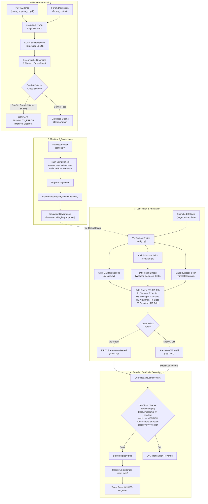
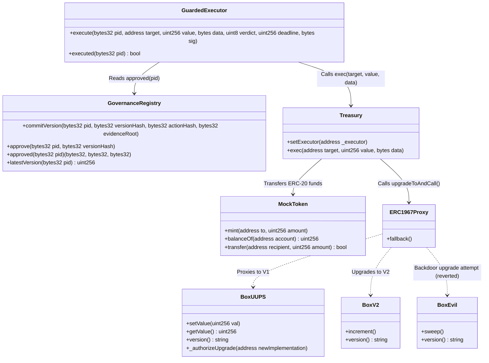
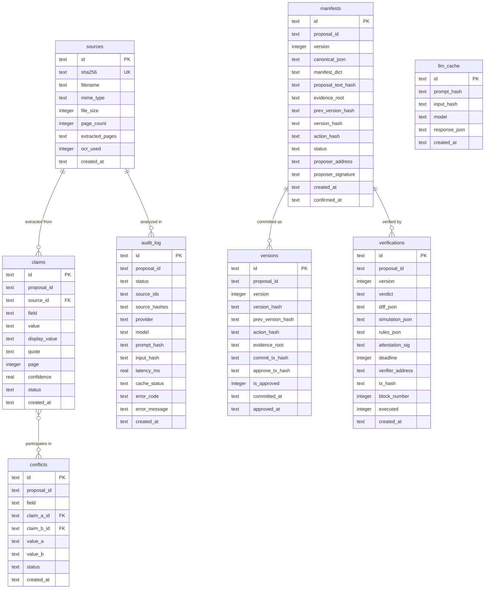

# CASCADE 4.1 — Complete Project Architecture Guide

**System Name:** CASCADE 4.1 DAO Accountability Engine  
**Event & Challenge:** CASCADE ’26, Problem 4.1  
**Authoritative Specifications:** `docs/dao-build-guide-final.md` and Problem 4.1 Statement  
**Repository Root:** `/Users/althea/Developer/Projects/iiitn-cascade/cascade4.1`  
**Current Baseline:** Verified Phase 7 (28/28 Foundry, 108/108 Pytest, Vite Build + Oxlint Clean)

---

## 1. Executive Architecture Overview

Modern DAO governance protocols (e.g., OpenZeppelin `Governor`) bind voter approvals to transaction calldata hashes (`proposalId = hash(targets, values, calldatas, descriptionHash)`). This prevents an attacker from swapping calldata post-vote. 

However, a critical vulnerability remains: **the natural-language proposal text and supporting evidence read by DAO members may not match the actual execution effects of the calldata**. A proposal describing a standard $1.0M grant may execute a $5.0M transfer, set a token allowance, grant an admin role, or upgrade a proxy to malicious bytecode containing a backdoor.

CASCADE 4.1 bridges this gap by establishing an immutable **Chain of Accountability**:
1. **Evidence Ingestion & Grounding:** PDFs and discourse posts are ingested; factual payout claims are extracted and deterministically grounded against source text (character-by-character substring verification).
2. **Conflict Detection:** Cross-source discrepancies (e.g. $5.0M PDF vs $5.8M forum post) are flagged, strictly blocking manifest creation.
3. **Canonical Manifest & Hash Chaining:** Approved claims are compiled into a deterministic canonical manifest and hashed into an on-chain sequential hash chain (`GovernanceRegistry.sol`).
4. **EVM Simulation:** Proposed transactions are simulated against an Anvil EVM snapshot through `Treasury.exec` with executor impersonation, observing watched balance deltas, allowances, and storage slots.
5. **Deterministic Rule Verification (R1–R7, R9):** Python rules compare observed simulation effects against the approved governance manifest. The LLM **never** decides verdicts.
6. **EIP-712 Attestation:** A trusted verifier signs an EIP-712 attestation **only** if all 8 rules evaluate to `VERIFIED`.
7. **Guarded On-Chain Execution:** The `GuardedExecutor.sol` contract enforces single-use execution, verifies the EIP-712 signature, checks the approved action hash, and routes execution through `Treasury.sol`.



---

## 2. Repository Directory Structure

```text
/Users/althea/Developer/Projects/iiitn-cascade/cascade4.1/
├── contracts/                  # Foundry Ethereum smart contracts
│   ├── src/                    # Production Solidity contracts (0.8.30)
│   │   ├── MockToken.sol       # ERC-20 (6 decimals) mimicking USDC with deployer mint
│   │   ├── GovernanceRegistry.sol # Sequential version chain & governance approval store
│   │   ├── Treasury.sol        # Vault contract holding DAO funds, restricted to executor
│   │   ├── GuardedExecutor.sol # EIP-712 attestation verifier & execution guard
│   │   ├── BoxUUPS.sol         # UUPS upgradeable implementation V1 (owned by Treasury)
│   │   ├── BoxV2.sol           # Benign V2 upgrade implementation
│   │   └── BoxEvil.sol         # Malicious V2 implementation with undeclared sweep() backdoor
│   ├── test/                   # Foundry test suites (28 tests)
│   │   ├── Stage1Core.t.sol    # Core contract unit and integration tests (21 tests)
│   │   ├── Upgrade.t.sol       # UUPS upgrade tests and backdoor execution tests (4 tests)
│   │   ├── Counter.t.sol       # Sample fuzzing tests (2 tests)
│   │   └── Dependency.t.sol    # OpenZeppelin import smoke test (1 test)
│   ├── lib/                    # Vendored dependencies (forge-std, openzeppelin-contracts)
│   └── foundry.toml            # Foundry configuration (solc 0.8.30, EVM cancun)
├── backend/                    # Python 3.11 backend managed exclusively via uv
│   ├── app/                    # FastAPI application package
│   │   ├── main.py             # FastAPI entry point, lifespan, and /health endpoint
│   │   ├── db.py               # SQLite connection pool, schema initialization, table migrations
│   │   ├── api/                # API router definitions
│   │   │   └── routes.py       # 21 REST API endpoints
│   │   ├── ingestion/          # Document extraction (PyMuPDF native text + RapidOCR fallback)
│   │   ├── claims/             # Pydantic schemas, text grounding, conflict detection, COI graph
│   │   ├── manifest/           # Canonical serialization, cryptographic hashing, manifest builder
│   │   ├── verification/       # Strict calldata decoder, Anvil simulation, rule engine (R1-R7, R9)
│   │   ├── chain/              # Web3 client, EIP-712 attestation signing, contract bindings
│   │   ├── scenarios/          # Automated scenario runner (Scenarios A, B1, B2, B3, C)
│   │   └── llm/                # LLM router, OpenAI/Gemini providers, SQLite cache, error shielding
│   ├── tests/                  # Pytest test suites (108 tests)
│   ├── data/                   # Runtime data directory (deployments.json, SQLite db)
│   └── pyproject.toml          # Project configuration, dependencies pinned to Python 3.11
├── frontend/                   # React 19 + TypeScript + Vite frontend workbench
│   ├── src/                    # Application source code
│   │   ├── main.tsx            # Vite DOM mount
│   │   ├── App.tsx             # Root component rendering AppShell
│   │   ├── api/                # API client (client.ts) and schema interfaces (types.ts)
│   │   ├── components/         # Reusable UI components
│   │   │   ├── common/         # Badges, CopyValue, AddressValue, HashValue, Modals, Icons
│   │   │   ├── layout/         # AppShell, persistent Sidebar, TopBar
│   │   │   ├── lifecycle/      # LifecycleStrip (8-stage governance progression tracker)
│   │   │   └── scenarios/      # ScenarioModal (interactive runner for A, B1, B2, B3, C)
│   │   ├── pages/              # Primary view pages
│   │   │   ├── OverviewPage.tsx      # System health, active proposal card, quick scenario launch
│   │   │   ├── ExecutionPage.tsx     # Calldata diff, EVM simulation deltas, R1-R9 checklist, execution
│   │   │   ├── ProposalsPage.tsx     # Evidence reader with quote highlights, claims, conflicts, COI
│   │   │   ├── ManifestPage.tsx      # Canonical JSON viewer, commitments, tamper verification
│   │   │   └── AuditPage.tsx         # Chronological audit log for analyses and verifications
│   │   └── styles/             # Modular CSS design system (tokens, background, components)
│   └── package.json            # Vite, React, TypeScript, Oxlint configuration
├── scripts/                    # Operational automation scripts
│   ├── deploy_and_seed.py      # Deterministic fast-reset and reseed automation (<1.6s)
│   ├── check_chain.py          # Quick CLI chain health probe
│   └── make_fixtures.py        # Generates clean test PDFs and fixtures
├── fixtures/                   # Sample proposals (clean_proposal_v1.pdf, clean_proposal_v2.pdf, forum_post.txt)
├── docs/                       # Project specifications, handoffs, and audit runbooks
├── .env.example                # Environment template without secrets
├── decisions.md                # Chronological record of architectural decisions
├── handoff.md                  # Milestone status and verification handoff logs
└── README.md                   # Setup instructions, capabilities, and quickstart
```

---

## 3. Frontend Architecture

### Framework & Configuration
- **Framework:** React 19 (`react` 19.2.4) with TypeScript (`tsc -b`).
- **Build Tool:** Vite 8.3.5 with `@vitejs/plugin-react`.
- **Linter:** Oxlint (`oxlint` 1.55.0) configured in `.oxlintrc.json`.
- **Entry Points:** [`frontend/index.html`](file:///Users/althea/Developer/Projects/iiitn-cascade/cascade4.1/frontend/index.html) mounts [`frontend/src/main.tsx`](file:///Users/althea/Developer/Projects/iiitn-cascade/cascade4.1/frontend/src/main.tsx), which renders [`frontend/src/App.tsx`](file:///Users/althea/Developer/Projects/iiitn-cascade/cascade4.1/frontend/src/App.tsx).

### Navigation & State Management
Navigation is tab-based and managed in [`AppShell.tsx`](file:///Users/althea/Developer/Projects/iiitn-cascade/cascade4.1/frontend/src/components/layout/AppShell.tsx):
- `currentTab`: Active view (`'overview' | 'execution' | 'proposals' | 'manifest' | 'audit'`).
- `proposalId`: Active proposal selector (`'PROP-002'`, `'PROP-001'`, `'PROP-B1'`).
- `manifest`: Active proposal's confirmed manifest object fetched from `/manifest/{pid}`.
- `deployments`: Active deployed contract addresses fetched from `/deployments`.
- `chainInfo`: Live RPC connectivity, `chainId`, and current block number from `/health`.
- `isBackendHealthy`: Backend reachability status.

```
AppShell
├── Sidebar (Branding, Navigation links, API status, Chain block number)
├── TopBar (Page title, Proposal selector dropdown, Scenario launcher pill, Refresh button)
├── Main Content Area
│   ├── OverviewPage (System summary, Lifecycle strip, Active proposal card, Scenario quick-links)
│   ├── ExecutionPage (Calldata comparison, EVM simulation deltas, R1-R9 checklist, Execution modal)
│   ├── ProposalsPage (Evidence document list, Extracted text reader, Claims table, Conflicts, COI card)
│   ├── ManifestPage (Commitment cards, Canonical JSON, Tamper test, On-chain version chain)
│   └── AuditPage (Unified chronological timeline of analyses and verifications)
└── ScenarioModal (Interactive step-by-step runner for Scenarios A, B1, B2, B3, C)
```

---

## 4. Backend API & Service Layer

The backend is built with **FastAPI** (`0.135.1`) running on Python 3.11 via `uv`. The entry point [`backend/app/main.py`](file:///Users/althea/Developer/Projects/iiitn-cascade/cascade4.1/backend/app/main.py) registers the lifecycle context (which runs `init_db()`), the `/health` endpoint, and mounts all application routes from [`backend/app/api/routes.py`](file:///Users/althea/Developer/Projects/iiitn-cascade/cascade4.1/backend/app/api/routes.py).

### Complete Endpoint Directory

| HTTP Method | Route Path | Handler Function | Primary Responsibilities |
| :--- | :--- | :--- | :--- |
| `GET` | `/health` | `health()` | Tests Web3 RPC connectivity, returns `chain_id`, `block_number`, and server status. |
| `GET` | `/deployments` | `get_active_deployments()` | Exposes active contract addresses (`token`, `registry`, `treasury`, `executor`, `box_*`). |
| `GET` | `/sources` | `list_sources_endpoint()` | Returns metadata for all ingested evidence documents. |
| `GET` | `/sources/{source_id}` | `get_source_detail_endpoint()` | Returns full details and extracted 1-indexed page text for a document. |
| `POST` | `/sources` | `create_source_endpoint()` | Ingests PDF (PyMuPDF) or text files, computes SHA-256, and stores in SQLite. |
| `POST` | `/analyze/{pid}` | `analyze_proposal_endpoint()` | Invokes `LLMRouter` to extract candidate claims from ingested documents. |
| `GET` | `/claims/{pid}` | `get_claims_for_proposal()` | Returns grounded claims, cross-source conflicts, and `cache_status`. |
| `GET` | `/proposals/{pid}/coi` | `get_proposal_coi_endpoint()` | Analyzes wallet provenance graph and returns shortest-path linkage trail. |
| `GET` | `/audit/{pid}` | `get_audit_trail_for_proposal()` | Retrieves LLM analysis audit entries (prompt hash, model, latency, status). |
| `POST` | `/manifest/{pid}` | `draft_manifest()` | Drafts canonical manifest if proposal is conflict-free; blocks with 422 if conflicts exist. |
| `POST` | `/manifest/{pid}/confirm` | `confirm_manifest()` | Signs manifest `versionHash` with proposer key and marks status `CONFIRMED`. |
| `GET` | `/manifest/{pid}` | `get_latest_manifest()` | Fetches the latest or specified version of a proposal manifest. |
| `POST` | `/commit/{pid}` | `commit_manifest_version_onchain()` | Calls `GovernanceRegistry.commitVersion` on-chain with hashes. |
| `POST` | `/approve/{pid}` | `approve_version_onchain()` | Simulates governance approval calling `GovernanceRegistry.approve`. |
| `GET` | `/versions/{pid}` | `get_versions_for_proposal()` | Queries on-chain version hash chain and approval status for a proposal. |
| `POST` | `/verify-version/{pid}` | `verify_version_integrity()` | Recomputes commitments from stored manifest and verifies on-chain match. |
| `POST` | `/verify` / `/{pid}` | `verify_proposal_endpoint()` | Runs EVM simulation, evaluates rules R1–R7, R9, issues EIP-712 attestation. |
| `POST` | `/execute` / `/{pid}` | `execute_proposal_endpoint()` | Executes proposal on-chain via `GuardedExecutor` with TOCTOU checks. |
| `GET` | `/verifications/{pid}` | `get_verifications_for_proposal()` | Retrieves verification history, simulation deltas, and execution receipts. |
| `POST` | `/scenarios/{name}/run` | `run_scenario_endpoint()` | Executes automated scenarios (`A`, `B1`, `B2`, `B3`, `C`) with thread locking. |

---

## 5. Ingestion, Claims Grounding & Conflict Detection

### Ingestion Pipeline ([`backend/app/ingestion/reader.py`](file:///Users/althea/Developer/Projects/iiitn-cascade/cascade4.1/backend/app/ingestion/reader.py))
- **PDF Extraction:** Uses **PyMuPDF** (`fitz`) to extract digital text on a 1-indexed page basis (`{"1": "page 1 text...", "2": "page 2 text..."}`).
- **OCR Fallback:** Pages with fewer than 50 characters (`MIN_USABLE_TEXT_LENGTH = 50`) automatically trigger the OCR fallback pipeline. In test/dev environments, a deterministic OCR mock handler extracts text without downloading multi-gigabyte neural network weights.
- **Deduplication:** Uploaded files are stored under `data/sources/<sha256>_<filename>` and indexed by content hash. Re-uploading the same file returns the existing record idempotently.

### Grounding & Numeric Verification ([`backend/app/claims/grounding.py`](file:///Users/althea/Developer/Projects/iiitn-cascade/cascade4.1/backend/app/claims/grounding.py))
Candidate claims extracted by the LLM adhere to a strict Pydantic schema:
`{field, value, quote, source_id, page, confidence}`.
1. **Normalization:** Quotes and source text are normalized by stripping excess whitespace, lowercasing, and normalizing Unicode dash variants (`–`, `—`, `−` $\rightarrow$ `-`).
2. **Substring Verification:** The normalized quote **must be an exact substring** of the document page text. If the LLM hallucinates or paraphrases a quote, the claim status is deterministically set to `REJECTED`.
3. **Numeric Cross-Check:** Any monetary numbers parsed from the quote are converted to base integer strings using `Decimal` (e.g. `"$5.0M"` $\rightarrow$ `5000000`). If the claimed `value` does not match the quote's numeric content, the claim is set to `REJECTED`.

### Conflict Detection Engine ([`backend/app/claims/conflicts.py`](file:///Users/althea/Developer/Projects/iiitn-cascade/cascade4.1/backend/app/claims/conflicts.py))
- Compares confirmed, grounded claims across differing sources for the same canonical field (e.g. `amount` or `recipient`).
- If differing sources assert conflicting values (e.g. `clean_proposal_v1.pdf` claims `5000000` while `forum_post.txt` claims `5800000`), a conflict entry is created with `status = 'CONFLICT'`, and both claims are tagged with `ClaimStatus.UNCERTAIN`.
- **Eligibility Gate:** In [`manifest/builder.py`](file:///Users/althea/Developer/Projects/iiitn-cascade/cascade4.1/backend/app/manifest/builder.py#L49), `check_claims_eligibility` queries `conflicts WHERE status IN ('UNRESOLVED', 'CONFLICT')`. If any conflict exists, manifest drafting and confirmation are refused with HTTP 422 `ELIGIBILITY_ERROR`.

---

## 6. Canonicalization, Hashing & EIP-712 Attestation

### Deterministic Canonicalization ([`backend/app/manifest/canon.py`](file:///Users/althea/Developer/Projects/iiitn-cascade/cascade4.1/backend/app/manifest/canon.py))
To ensure cryptographic digests are identical across different operating systems, JSON libraries, and languages:
- Keys are sorted alphabetically at every level.
- Whitespace is strictly eliminated (`separators=(',', ':')`).
- UTF-8 encoding without byte-order marks.
- Floating-point numbers are strictly rejected; monetary values are represented as integer strings.
- Ethereum addresses are normalized to lowercase.

### Cryptographic Hash Formulas ([`backend/app/manifest/hashes.py`](file:///Users/althea/Developer/Projects/iiitn-cascade/cascade4.1/backend/app/manifest/hashes.py))
1. **`proposalTextHash`:**
   $$\text{proposalTextHash} = \text{keccak256}(\text{UTF-8 proposal text seen by voters})$$
2. **`evidenceRoot`:**
   $$\text{evidenceRoot} = \text{keccak256}(\text{concatenation of sorted 32-byte SHA-256 source digests})$$
3. **`versionHash`:**
   $$\text{versionHash}_v = \text{keccak256}(\text{canonical\_json}_v \parallel \text{versionHash}_{v-1})$$
   *(For version 1, $\text{versionHash}_{0} = \text{0x00...00}$)*
4. **`actionHash`:**
   $$\text{actionHash} = \text{keccak256}(\text{abi.encode}(\text{address target}, \text{uint256 value}, \text{keccak256}(\text{bytes calldata})))$$

### EIP-712 Attestation Domain & Typed Data ([`backend/app/chain/attest.py`](file:///Users/althea/Developer/Projects/iiitn-cascade/cascade4.1/backend/app/chain/attest.py))
- **Domain:** `name = "GuardedExecutor"`, `version = "1"`, dynamic `chainId`, `verifyingContract = executor_address`.
- **Type String:** `Attestation(bytes32 proposalId,bytes32 versionHash,bytes32 actionHash,bytes32 evidenceRoot,uint8 verdict,uint256 deadline)`
- **Issuance Rule:** Signed exclusively by the trusted verifier key (`PK_VERIFIER`) and **only** when all deterministic rules pass (`verdict == VERIFIED`).
- **Deadline Calculation:** Derived from the current Anvil EVM block timestamp (`w3.eth.get_block('latest')['timestamp'] + ttl`), avoiding system clock drift issues.

---

## 7. EVM Simulation & Deterministic Rule Engine

### Simulation Architecture ([`backend/app/verification/simulate.py`](file:///Users/althea/Developer/Projects/iiitn-cascade/cascade4.1/backend/app/verification/simulate.py))
The simulation executes against the local Anvil node without persisting state:
1. **Snapshot:** Calls raw JSON-RPC `evm_snapshot` to capture state.
2. **Impersonation:** Calls `anvil_impersonateAccount(executor_address)`.
3. **Pre-State Capture:** Records baseline ETH balances, ERC-20 token balances, allowances, and EIP-1967 implementation slots across watched addresses (Treasury, Recipient, calldata targets, and dynamic addresses).
4. **Execution:** Dispatches `treasury.exec(target, value, data)` directly from the impersonated executor.
5. **Post-State Capture:** Re-reads all watched state and parses emitted logs (e.g. `Transfer` events expand the watchlist).
6. **Reversion & Verification:** Dispatches `evm_revert(snapshot_id)`. Verifies that the world reverted cleanly by asserting that executor nonce, block number, and watchlist balances match the pre-state.
7. **Effects Computation:** Calculates $\Delta = \text{post\_state} - \text{pre\_state}$.

### Deterministic Rule Engine ([`backend/app/verification/verify.py`](file:///Users/althea/Developer/Projects/iiitn-cascade/cascade4.1/backend/app/verification/verify.py))
Section 5.6 of the build guide specifies 8 deterministic rules (R1–R7, R9; Rule R8 is unassigned):

| Rule ID | Rule Name | Evaluation Logic & Invariants | Failure Verdict |
| :---: | :--- | :--- | :---: |
| **R1** | **Approved Version & Governance** | Rebuilds manifest, recomputes `versionHash`, and asserts equality with `registry.approved(pid).versionHash`. Verifies proposer signature. | `MISMATCH` |
| **R2** | **Action Hash & Parameters** | Computes submitted `actionHash` from `(target, value, calldata)` and asserts exact match with approved `actionHash`. Compares decoded fields (token, recipient, amount). | `MISMATCH` |
| **R3** | **Token Outflow Envelope** | Asserts Treasury token outflow $\le$ `manifest.envelope.maxAllowedOutflow` and Recipient token inflow $\ge$ expected amount. | `MISMATCH` |
| **R4** | **Prohibited Balance Increases** | Asserts zero unexpected balance increases on unapproved watched accounts (e.g. attacker addresses). | `MISMATCH` |
| **R5** | **Allowance Modifications** | Asserts Treasury token allowances remain strictly unchanged unless `manifest.envelope.allowApprovals == true`. | `MISMATCH` |
| **R6** | **Implementation Slot Immutability** | Verifies EIP-1967 proxy storage slot (`0x360894a1...`). Payouts require strict immutability; upgrades require exact match with `manifest.action.newImpl`. | `MISMATCH` |
| **R7** | **Selector Whitelist / Scope** | Static EVM bytecode scanner inspects runtime code of `newImpl`. Selectors must reside within $\text{baselineSelectors} \cup \text{declaredSelectors}$. | `MISMATCH` |
| **R9** | **Owner / Access Role Immutability** | Asserts contract ownership (`owner()`) and access control roles remain unchanged during transaction execution. | `MISMATCH` |

---

## 8. Smart Contract Architecture

The contracts live in `contracts/src/` and are compiled with Solidity **0.8.30** using Foundry:



### Contract Responsibilities
1. **[`MockToken.sol`](file:///Users/althea/Developer/Projects/iiitn-cascade/cascade4.1/contracts/src/MockToken.sol):** OpenZeppelin ERC-20 implementation (6 decimals) representing USDC. Minting is deployer-restricted (`onlyDeployer`), preventing unauthorized balance inflation during test runs.
2. **[`GovernanceRegistry.sol`](file:///Users/althea/Developer/Projects/iiitn-cascade/cascade4.1/contracts/src/GovernanceRegistry.sol):** 
   - Proposer ownership: Only the first committer of a `pid` can commit sequential versions (`v = 1, 2, ...`).
   - Revision Invalidation: When `commitVersion` is called, any prior active approval for that `pid` is cleared (`delete _approved[pid]`), strictly invalidating old approvals when proposal text changes.
   - Simulated Governance Approval: Calling `approve(pid, versionHash)` copies `(versionHash, actionHash, evidenceRoot)` into `_approved[pid]`.
3. **[`Treasury.sol`](file:///Users/althea/Developer/Projects/iiitn-cascade/cascade4.1/contracts/src/Treasury.sol):** Holds the DAO's USDC funds and owns protocol proxies. Dispatches external calls via `exec(target, value, data)`. Enforces `require(msg.sender == executor, "only executor")`. `setExecutor` can only be called once by the deployer.
4. **[`GuardedExecutor.sol`](file:///Users/althea/Developer/Projects/iiitn-cascade/cascade4.1/contracts/src/GuardedExecutor.sol):** The trust anchor of the system:
   - Inherits OpenZeppelin `EIP712` and uses `ECDSA.recover`.
   - Replay protection: `require(!executed[pid], "already executed")`.
   - Deadline validation: `require(block.timestamp <= deadline, "attestation expired")`.
   - Verdict enforcement: `require(verdict == VERIFIED, "not verified")`.
   - Action binding: `require(ah == approvedAction, "action mismatch")`.
   - Signature recovery: `require(ECDSA.recover(digest, sig) == verifier, "bad attestation")`.
   - Sets `executed[pid] = true` before dispatching `treasury.exec(...)`.
5. **UUPS Upgrade Contracts ([`BoxUUPS.sol`](file:///Users/althea/Developer/Projects/iiitn-cascade/cascade4.1/contracts/src/BoxUUPS.sol), [`BoxV2.sol`](file:///Users/althea/Developer/Projects/iiitn-cascade/cascade4.1/contracts/src/BoxV2.sol), [`BoxEvil.sol`](file:///Users/althea/Developer/Projects/iiitn-cascade/cascade4.1/contracts/src/BoxEvil.sol)):**
   - Deployed behind OpenZeppelin `ERC1967Proxy`. Ownership is granted to `Treasury`.
   - `BoxUUPS`: Initial version ("1.0.0"), `setValue()`, `getValue()`.
   - `BoxV2`: Benign version ("2.0.0"), adds `increment()`.
   - `BoxEvil`: Malicious implementation containing an undeclared `sweep()` backdoor (`0x35faa416`).

---

## 9. Database Schema & Persistence

The application uses Python's standard-library `sqlite3` at `data/dao_accountability.db`, initialized via [`backend/app/db.py`](file:///Users/althea/Developer/Projects/iiitn-cascade/cascade4.1/backend/app/db.py).



---

## 10. LLM Subsystem, Error Shielding & Offline Caching

The LLM subsystem lives in `backend/app/llm/`:
- **Protocol:** `LLMProvider` protocol defines `extract_claims(prompt, sources) -> List[Dict]`.
- **Router:** [`LLMRouter`](file:///Users/althea/Developer/Projects/iiitn-cascade/cascade4.1/backend/app/llm/router.py) orchestrates SQLite caching, retry policies, and audit trail records.
- **Provider:** [`OnlineLLMProvider`](file:///Users/althea/Developer/Projects/iiitn-cascade/cascade4.1/backend/app/llm/online.py) connects to OpenAI / Gemini / OpenRouter compatible endpoints.

### Resilience & Error Handling Architecture
1. **HTTP 429 Rate-Limit Handling:** Parses the `Retry-After` header value to determine backoff and raises `LLMUnavailableError(f"LLM rate limit exceeded (HTTP 429), retry after {seconds}s")`.
2. **HTTP 5xx Server Error Sanitization:** Intercepts 500, 502, 503, and 504 errors, shielding internal server stack traces and logging generic provider failure notices.
3. **Timeout & Network Drops:** Catches `httpx.TimeoutException` and `httpx.ConnectError` cleanly.
4. **Credential Redaction:** Every exception handler inspects error messages for `self.api_key` and scrubs any occurrences with `[REDACTED]`.
5. **Fail-Closed Gate:** LLM failures never approve proposals. When an LLM fails, an empty claim set or `LLMUnavailableError` is returned. The manifest builder rejects proposals lacking grounded claims with HTTP 422 `ELIGIBILITY_ERROR`.
6. **Offline Caching:** Cached extractions lookup entries by `prompt_hash` and `input_hash`. When pre-cached, the router operates 100% offline without network connectivity. If source evidence is modified, `input_hash` changes, producing a cache miss that safely fails closed rather than serving stale claims.

---

## 11. Deployment, Seeding & Reset Scripts

### Reset & Reseed Script ([`scripts/deploy_and_seed.py`](file:///Users/althea/Developer/Projects/iiitn-cascade/cascade4.1/scripts/deploy_and_seed.py))
- **Execution:** `uv run --project backend python scripts/deploy_and_seed.py`
- **Speed:** Completes full redeployment, funding, and seeding in **~1.51 seconds**.
- **Virtualenv Auto-Bootstrapping:** Checks for `eth_account` and `web3`; if invoked from an unconfigured shell, transparently re-execs into `backend/.venv/bin/python`.
- **Environment Protection:** Evaluates RPC host; rejects non-loopback hosts or chain IDs other than `31337` and `1337`.
- **Seed States Created:**
  - `PROP-002`: Clean $1.0M grant to Alice; confirmed manifest v1; approved by governance on-chain.
  - `PROP-001`: Genuine conflict between `clean_proposal_v1.pdf` ($5.0M) and `forum_post.txt` ($5.8M); claims marked `ClaimStatus.UNCERTAIN`; conflict marked `status = 'CONFLICT'`.
- **Artifacts Written:** Synchronizes [`data/deployments.json`](file:///Users/althea/Developer/Projects/iiitn-cascade/cascade4.1/data/deployments.json) and [`backend/data/deployments.json`](file:///Users/althea/Developer/Projects/iiitn-cascade/cascade4.1/backend/data/deployments.json).

---

## 12. Source of Truth Matrix

| Value / State Entity | Where It Lives | Source of Truth | How It Is Verified |
| :--- | :--- | :--- | :--- |
| **Active Contract Addresses** | `deployments.json` / Memory | On-Chain Anvil Deployment Receipts | `GET /deployments` / `check_chain.py` |
| **Voter-Facing Proposal Prose** | Document Files (`fixtures/`) | `proposalTextHash` | `keccak256(proposal_text)` matches manifest |
| **Supporting Evidence Files** | `data/sources/<sha256>_*` | `evidenceRoot` | `keccak256(sorted_sha256_digests)` matches manifest |
| **Approved Governance Tuple** | `GovernanceRegistry.sol` | On-Chain Storage Mapping `_approved[pid]` | `registry.approved(pid)` returns `(versionHash, actionHash, evidenceRoot)` |
| **Version Hash History Chain** | `GovernanceRegistry.sol` / SQLite | On-Chain Event `VersionCommitted` & `_versions[pid]` | `registry.getVersion(pid, v)` |
| **Factual Claim Grounding** | `claims` table (SQLite) | Substring Match on Extracted Pages | `claims/grounding.py` exact substring check |
| **Verification Rule Verdict** | `verifications` table (SQLite) | Python Deterministic Evaluation | Re-running `verify_proposal_transaction()` |
| **Execution Permission** | Verifier ECDSA Key / Attestation | Signed EIP-712 Digest | `ECDSA.recover(digest, sig) == verifier` |
| **Single-Use Replay Status** | `GuardedExecutor.sol` | On-Chain Mapping `executed[pid]` | `executor.executed(pid) == true` |
| **DAO Vault USDC Balance** | `MockToken.sol` | On-Chain Balance `balanceOf(treasury)` | `token.balanceOf(treasury)` Web3 call |
| **Proxy Implementation Pointer** | `ERC1967Proxy.sol` | Storage Slot `0x360894a1...` | `w3.eth.get_storage_at(proxy, slot)` |
| **COI Provenance Graph** | `app/claims/coi.py` | Seeded Demonstration Graph | Flagged explicitly as `is_demo_data: true` |

---

## 13. Component-by-Component Deep Dive

### 1. Ingestion Engine (`backend/app/ingestion/reader.py`)
1. **What it does:** Reads digital PDFs and text files, extracts text page-by-page, and manages OCR fallbacks.
2. **Why it exists:** Provides grounded evidence text with 1-indexed page coordinates so quotes can be strictly verified.
3. **What calls it:** `POST /sources` in `routes.py`, `LLMRouter`, and `deploy_and_seed.py`.
4. **What it calls:** PyMuPDF (`fitz`), hashlib, filesystem storage.
5. **Data in/out:** Input: raw file bytes or text string. Output: `SourceDocument` dictionary with SHA-256 and `extracted_pages`.
6. **Tests verifying it:** `backend/tests/test_ingestion.py` (7 tests).

### 2. Grounding & Conflict Engine (`backend/app/claims/`)
1. **What it does:** Verifies candidate claims against document text and identifies cross-source contradictions.
2. **Why it exists:** Prevents fabricated LLM claims and detects contradictory evidence before manifests can be drafted.
3. **What calls it:** `POST /analyze/{pid}` in `routes.py`, `check_claims_eligibility` in `builder.py`.
4. **What it calls:** `normalize_text()`, `find_quote_in_text()`, SQLite `conflicts` and `claims` tables.
5. **Data in/out:** Input: `RawExtractedClaim` list and source text. Output: `GroundedClaim` records and `Conflict` records.
6. **Tests verifying it:** `test_grounding.py` (9 tests), `test_conflicts.py` (3 tests).

### 3. Manifest Builder & Canon (`backend/app/manifest/`)
1. **What it does:** Converts grounded claims into deterministic canonical JSON and calculates cryptographic commitments.
2. **Why it exists:** Establishes an immutable, machine-readable definition of governance intent that can be committed on-chain.
3. **What calls it:** `POST /manifest/{pid}`, `POST /manifest/{pid}/confirm`, `verify_proposal_transaction`.
4. **What it calls:** `canon.py`, `hashes.py`, `eth_account`.
5. **Data in/out:** Input: Grounded claims list, token address, proposer key. Output: Canonical JSON string, `versionHash`, `actionHash`, `evidenceRoot`.
6. **Tests verifying it:** `test_canon.py` (6 tests), `test_hashes.py` (4 tests), `test_manifest_builder.py` (5 tests).

### 4. Verification Engine (`backend/app/verification/verify.py`)
1. **What it does:** Coordinates calldata decoding, Anvil simulation, bytecode scanning, and rules evaluation (R1–R7, R9).
2. **Why it exists:** Enforces that submitted transactions conform strictly to what governance approved before execution is permitted.
3. **What calls it:** `POST /verify`, `POST /scenarios/{name}/run`.
4. **What it calls:** `decode.py`, `simulate.py`, `scan_bytecode()`, `sign_attestation()`.
5. **Data in/out:** Input: `proposal_id`, `(target, value, calldata)`, contract addresses. Output: `VerificationReport` with rule outcomes and optional EIP-712 signature.
6. **Tests verifying it:** `test_verify_rules.py` (10 tests), `test_upgrade_verification.py` (9 tests).

### 5. GuardedExecutor Contract (`contracts/src/GuardedExecutor.sol`)
1. **What it does:** Enforces on-chain governance integrity immediately before execution.
2. **Why it exists:** The ultimate on-chain defense boundary preventing execution of unauthorized or tampered transactions.
3. **What calls it:** `POST /execute` in `routes.py`, `runner.py`, or external callers.
4. **What it calls:** `GovernanceRegistry.approved(pid)`, OpenZeppelin `ECDSA.recover`, `Treasury.exec()`.
5. **Data in/out:** Input: `(pid, target, value, data, verdict, deadline, sig)`. Output: Dispatches execution to Treasury or reverts.
6. **Tests verifying it:** `contracts/test/Stage1Core.t.sol` (21 tests).

### 6. Automated Scenario Runner (`backend/app/scenarios/runner.py`)
1. **What it does:** Orchestrates end-to-end execution of Scenarios A, B1, B2, B3, and C.
2. **Why it exists:** Provides deterministic, repeatable, and automated validation for live demonstrations and testing.
3. **What calls it:** `POST /scenarios/{name}/run` via frontend `ScenarioModal` or curl.
4. **What it calls:** `deploy_and_seed.py`, `verify_proposal_transaction()`, Web3 contract calls.
5. **Data in/out:** Input: scenario name (`A`, `B1`, `B2`, `B3`, `C`). Output: Step-by-step logs, verification report, receipts, and state deltas.
6. **Tests verifying it:** `backend/tests/test_scenarios_runner.py` (14 tests).
